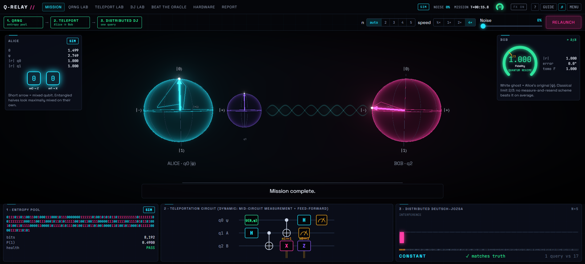

# Q-RELAY

**A quantum-network mission control for Qiskit Fall Fest 2026 (DBATU, Lonere).** A quantum random number generator seeds a secret state and a hidden oracle. Alice **teleports** the state to Bob with a dynamic circuit. Then she teleports a |−⟩ that becomes Bob's ancilla for a one-query **Deutsch–Jozsa** run. All three problem statements live in one pipeline, shown live in 3-D, with a single noise slider that lets you watch quantum advantage decay through the classical limit of 2/3.



## Quick start

```powershell
# Windows (PowerShell)
.\tasks.ps1 setup      # venv + Python deps + web deps + jupyter kernel
.\tasks.ps1 demo       # build the UI and serve everything at http://127.0.0.1:8000
```
```bash
# macOS / Linux
make setup && make demo
```
Other targets: `test` (53 tests), `dev` (API :8000 + Vite :5173 with hot reload), `precompute` (noise sweeps and comparisons), `notebooks` (regenerate and execute notebooks), `report` (figures), `smoke` (headless UI test). **No internet or IBM account is needed to run the demo.** Cached and emulated results ship in `data/`.

The app opens on a **title screen** (Continue / New Mission / Music / Mission Guide). The **Mission Guide** is an 8-step tutorial in plain language, and the **?** button explains the current screen in simple words. Music is generated live in the browser (no audio files): its notes are picked by QRNG bits, and it gets muddier as you raise the noise.

Hotkeys: `1–7` screens · `D` 90-second auto demo · `H` help · `G` guide · `M` music · `Esc` title menu · `P` presenter captions · `L` low-power mode.

## What's inside

| Problem statement requirement | Where |
|---|---|
| **PS1** teleport an arbitrary state (entanglement + classical communication) | `qrelay/teleport.py` (dynamic `if_test` circuit, deferred variant, density-matrix step engine) · Teleport Lab · `notebooks/01_teleportation.ipynb` |
| PS1 explanation | `docs/THEORY.md` §1 · notebook 01 · live captions |
| PS1 fidelity measure | exact per-branch ⟨ψ\|ρ\|ψ⟩, our own X/Y/Z tomography, 200 Haar states (from QRNG bits), cardinal states, Pauli transfer matrix, **2/3 classical bound** |
| PS1 noise and hardware | `qrelay/noise.py` · 1-D and 2-D sweeps with the quantum-advantage threshold · readout mitigation · `scripts/run_hardware.py` · Hardware page |
| **PS2** QRNG circuit and diagram | `qrelay/qrng.py` · QRNG Lab · `notebooks/02_qrng.ipynb` |
| PS2 bit sequence and statistics | 1,000,000 bits · 10 NIST SP 800-22 tests implemented in `qrelay/stats.py` · Shannon and min-entropy |
| PS2 frequency visualisation | histogram with ±3σ band, bit fingerprints, random walk, autocorrelation |
| PS2 QRNG vs classical PRNG | PCG64, Mersenne Twister and RANDU (control, fails 6/10) · simulator vs emulated vs hardware |
| PS2 bias mitigation | `qrelay/extract.py`: Von Neumann, XOR, Toeplitz hashing, with yields |
| **PS3** DJ for n-qubit input | `qrelay/dj.py`, n = 1…8 · DJ Lab · `notebooks/03_deutsch_jozsa.ipynb` |
| PS3 ≥ 2 constant + 2 balanced oracles | 2 constant + 4 balanced (x₀, parity, inner product, random balanced) plus an equivalent phase oracle |
| PS3 diagrams and results | circuits, counts (all-zeros ⇔ constant), **exhaustive proof for n ≤ 3** |
| PS3 superposition / phase kickback / interference | step-through amplitude bars (UI, notebook, THEORY §3) |
| PS3 query counts | 1 vs 2ⁿ⁻¹+1, log-scale chart, **adversary simulation** |
| **Integration** | `qrelay/distributed_dj.py`: teleported-ancilla DJ · proof that balanced success = ancilla teleport fidelity (THEORY §4) · `notebooks/04_qrelay_mission.ipynb` |

Report: [`docs/REPORT.md`](docs/REPORT.md) · Theory: [`docs/THEORY.md`](docs/THEORY.md) · Demo script and judge Q&A: [`docs/DEMO_SCRIPT.md`](docs/DEMO_SCRIPT.md) · Sources: [`docs/REFERENCES.md`](docs/REFERENCES.md) · Engineering log: [`docs/DECISIONS.md`](docs/DECISIONS.md)

## Architecture

```
qrelay/            pure-Python quantum library (no web code)
  qrng.py stats.py extract.py      PS2
  teleport.py noise.py bloch.py    PS1
  dj.py distributed_dj.py          PS3 + integration
  mission.py                       event stream: QRNG -> teleport -> DJ
  hardware.py                      IBM Runtime batch, caching, analysis
server/main.py     FastAPI: REST + WebSocket /ws/mission (offline, no token needed)
web/               Vite + React + TypeScript + three.js (react-three-fiber), zustand, framer-motion
notebooks/         executed, thin notebooks for each problem
scripts/           run_hardware.py · precompute_sweeps.py · build_report_figures.py · build_notebooks.py · smoke_ui.py
data/              cached sweeps, QRNG pools, hardware/emulated results (JSON + job IDs)
tests/             53 pytest tests (core, noise, API + WebSocket)
```

## Running on IBM Quantum hardware

The token is never stored in this repo. Either save an account once:

```python
from qiskit_ibm_runtime import QiskitRuntimeService
QiskitRuntimeService.save_account(channel="ibm_quantum_platform", token="<API key>", instance="<instance CRN>", set_as_default=True)
```
or set the environment variables `QISKIT_IBM_TOKEN` and `QISKIT_IBM_INSTANCE`. Then:
```powershell
.venv\Scripts\python scripts\run_hardware.py --dry-run     # pick backend, transpile, estimate QPU time
.venv\Scripts\python scripts\run_hardware.py --submit      # one job: QRNG + teleport tomography + DJ + distributed DJ
.venv\Scripts\python scripts\precompute_sweeps.py --only qrng_compare extractors   # fold HW bits into comparisons
```
Results land in `data/hardware/hw_batch_*.json` with backend, job ID, timestamp, transpiled depth and 2-qubit gate counts, and versions. The app and notebooks pick them up automatically, labelled **HW**.

## Honesty notes

* **Aer is a classical simulator.** Its measurement outcomes come from a classical PRNG, so **SIM** bits are pseudo-random. Only **HW** bits are physically random. **EMU** means Aer with a real device's calibration snapshot (`FakeBrisbane`), and it is never presented as hardware.
* Average teleportation fidelity **> 2/3** is what certifies a quantum channel.
* Passing statistical tests means no structure was found. It is not a proof of randomness.
* Every figure in the report is regenerated from real runs by `scripts/build_report_figures.py`.

## Versions

Python 3.12.5 · Qiskit 2.6.1 · qiskit-aer 0.18.2 · qiskit-ibm-runtime 0.51.0 · NumPy 2.5.4 · SciPy 1.18.1 · FastAPI 0.162 · Node 22 · React 19 · three 0.186. Pinned in `requirements.txt` and `web/package.json`.

## Credits

Built for Qiskit Fall Fest 2026 at DBATU. All code is original. Ideas and algorithms are credited in [`docs/REFERENCES.md`](docs/REFERENCES.md).
