# Q-Relay: QRNG → Teleportation → Distributed Deutsch–Jozsa

**Qiskit Fall Fest 2026 · DBATU, Lonere.** All three problem statements, built as one pipeline in which each stage depends on the previous one, with every result labelled by source: **SIM** (Aer simulator), **EMU** (Aer plus the noise model of a real IBM device snapshot, `FakeBrisbane`) or **HW** (real IBM hardware, with job ID).

Stack: Python 3.12.5, Qiskit 2.6.1, qiskit-aer 0.18.2, qiskit-ibm-runtime 0.51.0, NumPy 2.5.4, SciPy 1.18.1. Code: `qrelay/` (library), `notebooks/01–04` (executed), `tests/` (53 tests), `web/` + `server/` (interactive demo). Derivations: `docs/THEORY.md`.

> **Honesty notes.** (1) Aer's measurement outcomes come from a classical PRNG, so SIM "quantum" bits are pseudo-random. Only HW bits are physically random. (2) EMU results are never presented as hardware. (3) Passing statistical tests does not prove randomness. (4) A teleportation channel is certified quantum only when average fidelity exceeds the classical bound 2/3. Hardware numbers come from one IBM job (`dbgnmpote5oc738iia1g`, ibm_marrakesh, 2026-10-28).

---

## 1. PS1: Quantum teleportation

**Approach.** Alice holds $|\psi\rangle=\cos\frac\theta2|0\rangle+e^{i\varphi}\sin\frac\theta2|1\rangle$ (q0) and half of a Bell pair (q1). Bob holds q2. The primary implementation is a **dynamic circuit**: mid-circuit Bell-basis measurement and classical feed-forward via `if_test` (X if $m_1$, then Z if $m_0$). A **deferred-measurement** variant (CX/CZ corrections) serves as the universal fallback. A third engine evolves the 3-qubit density matrix gate by gate and records every qubit's Bloch vector for the visualisation.

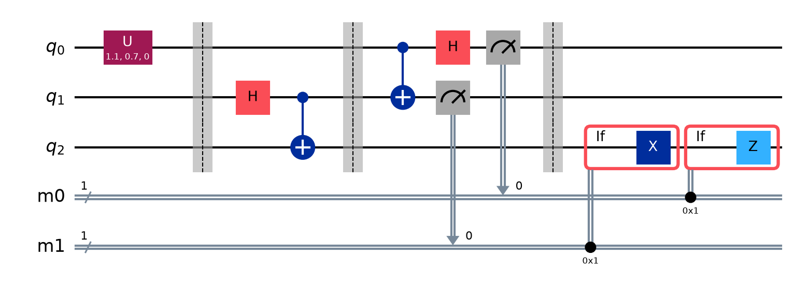

**Verification.** Four independent measures:

| check | result [SIM] |
|---|---|
| Exact $F=\langle\psi\vert\rho_B\vert\psi\rangle$ in **each** of the 4 branches (Aer conditional density matrices) | 1.000000000 in every branch, for 50 random states, both variants |
| 6 cardinal states, Pauli transfer matrix | $R=I$ (to 1e-9), $F_{pro}=1$ |
| Tomography (Z/X/Y bases, our implementation), 200 Haar states from the QRNG pool, 1024 shots/basis | $\bar F=0.9916\pm0.0050$ (finite-shot spread) |
| Exact average over the same 200 states | mean $1.0000000000$, min $0.9999999999999994$ |

The step engine shows the physics: after the Bell CX both q1 and q2 have $|\vec r|=0$ (maximally mixed halves). After Alice's measurement q0 collapses to a pole (**no-cloning**: moved, not copied). Bob's arrow snaps onto $|\psi\rangle$ only after the corrections.

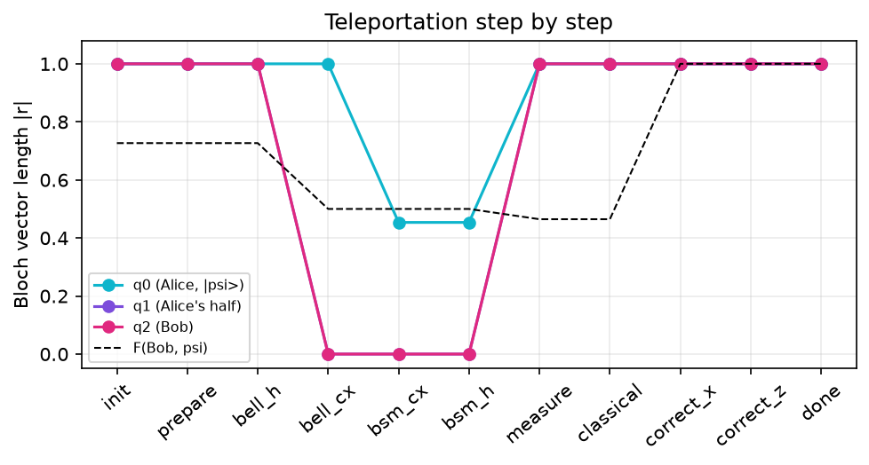

**Noise analysis.** Noise is inserted as explicit error channels after every gate (`qrelay.noise.noisify`, recursing into the `if_else` blocks). Average fidelity is computed exactly from the PTM via $F_{avg}=(2F_{pro}+1)/3$.

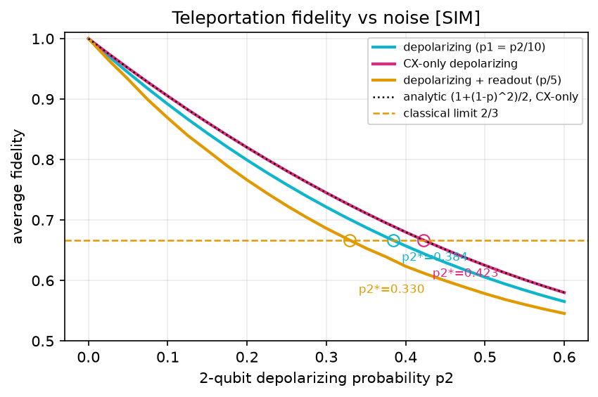

* With CX-only depolarizing noise, simulation and our closed form $F=(1+(1-p)^2)/2$ (THEORY §1.3) agree to $10^{-6}$. The **quantum-advantage threshold** is $p_2^*=1-1/\sqrt3=0.4226$.
* Adding 1-qubit noise ($p_1=p_2/10$) lowers it to $p_2^*=0.384$. Adding readout error ($p/5$) lowers it to $0.330$. Readout matters because it corrupts **Alice's feed-forward bits**.
* Thermal relaxation (gate times 50/300 ns): $F_{avg}=0.997$ at $T_1=T_2=200\,\mu s$, $0.945$ at $10\,\mu s$, and it crosses 2/3 near $1\,\mu s$.
* **Readout mitigation** (confusion-matrix inversion) on the noisy model ($p_1{=}0.01,p_2{=}0.1$, readout $0.02$): cardinal-state tomography $0.853\to0.868$. Mitigation cannot fix flipped feed-forward bits. For $|+\rangle$ with readout flip $p$ the mitigated ceiling is exactly $1-p$ (measured $0.924$ at $p=0.08$).

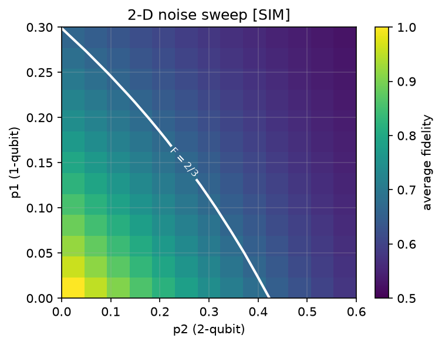

**Real hardware [HW, IBM ibm_marrakesh (156-qubit Heron), job `dbgnmpote5oc738iia1g`, 4096 shots, cardinal-state tomography].** Deferred-measurement circuit: $F_{avg}=0.978$ (per state 0.958–0.984, PTM diagonal 0.95/0.97/0.95). Dynamic circuit with real mid-circuit measurement and feed-forward: $F_{avg}=0.880$. The $|0
angle,|1
angle$ states stay at 0.96–0.98, but the equatorial states drop to about 0.82, and the PTM shows X/Y = 0.65/0.69 against Z = 0.94. That is the signature of **dephasing while the qubit waits for the classical feed-forward**. Both circuits are far above 2/3: **genuine quantum teleportation on hardware.** The whole batch used 55 s of QPU time. For comparison, the emulated device (EMU, fake_brisbane) gave 0.965 / 0.962.

## 2. PS2: Quantum random number generator

**Approach.** $H$ then measure, on 16 parallel qubits per shot (a 1-qubit textbook circuit and an $m$-qubit version). **1,000,000 bits** generated on the simulator in about 2 s, and **819,200 physically random bits** from IBM ibm_marrakesh (100 qubits × 8192 shots). Little-endian ordering is handled explicitly (`qrng.memory_to_bits`).

**Statistics.** 10 NIST SP 800-22-style tests implemented from the specification ($\alpha=0.01$), plus Shannon and min-entropy:

| generator (1M bits) | passed | min-entropy / byte | notes |
|---|---|---|---|
| QRNG [SIM] | **10/10** | 7.807 | lowest p = 0.015 (runs) |
| PCG64 | 10/10 | 7.828 | |
| Mersenne Twister | 10/10 | 7.828 | |
| **RANDU** (low byte) | **4/10** | 5.999 | fails longest-run, serial, ApEn, DFT, autocorrelation, byte χ² with p < 1e-4 |
| **QRNG [HW] ibm_marrakesh** (819,200 bits) | **8/10** | 7.811 | fails monobit and cumulative sums (p = 0.002): a real per-qubit bias, P(1) from 0.435 to 0.530 |
| QRNG [EMU] (163,840 bits) | 10/10 | 7.489 | smaller sample, so lower plug-in min-entropy |

RANDU is the control that proves the suite discriminates. Its **bit fingerprint** shows stripes where the others look like noise:

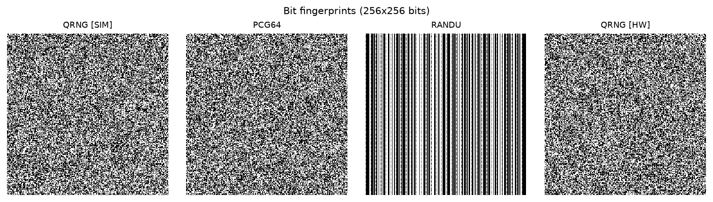

**Interpretation.** The quantum and classical generators are statistically indistinguishable by these tests, which is expected, because the tests cannot detect *where* randomness comes from. The value of a QRNG is the physical unpredictability of **hardware** bits, which no test can certify. The simulator's bits are, honestly, PRNG output.

**Bias mitigation** on a physically motivated biased source (asymmetric readout $P(0|1)=0.2$, so $P(1)=0.399$, $H_\infty=0.735$/bit), 400k bits:

| method | P(1) out | yield | tests |
|---|---|---|---|
| raw | 0.3993 | 100% | 0/10 |
| Von Neumann | 0.5011 | 23.9% | 10/10 |
| XOR pairs | 0.4789 | 50% | 2/10 (bias $0.1\to0.02=2\varepsilon^2$, as predicted) |
| Toeplitz hashing ($n=1024$, $\varepsilon=2^{-32}$) | 0.4989 | 67.2% | 10/10 |

Toeplitz recovers nearly the source's min-entropy, about 3× Von Neumann's yield, at the cost of an independent seed. **On the real hardware bits** ($P(1)=0.5017$, 8/10 tests), every extractor restores 10/10: Von Neumann keeps 25%, XOR 50%, and Toeplitz 93% (763,200 bits). The first 200k hardware bits alone pass all tests; the bias only becomes detectable with the full sample.

## 3. PS3: Deutsch–Jozsa

**Approach.** General $n$ (tested 1–8). Oracles: 2 constant (identity, X), and balanced $x_0$, parity, inner product $a\cdot x$ and **random balanced** (a random half of the inputs, via MCX), plus an equivalent `Diagonal` phase oracle that tests show matches the bit oracle on every input. Random oracles draw from the QRNG pool.

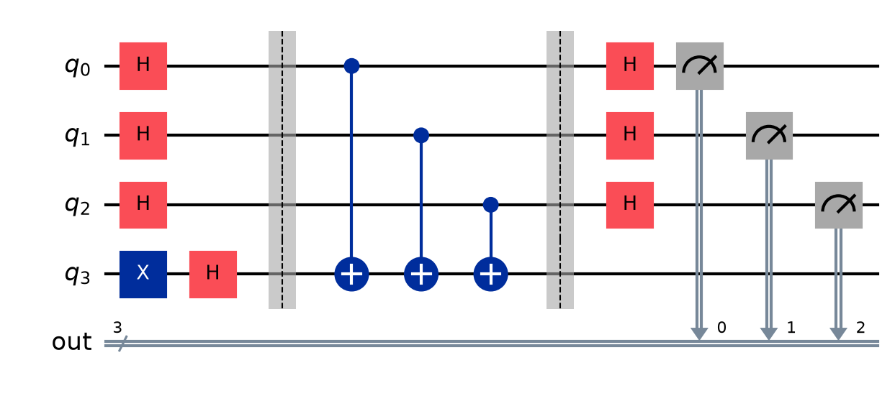

**Correctness.** We enumerate **every** function for $n=1,2,3$ (2 constant and 2, 6, 70 balanced) and confirm $P(0^n)=1$ or $0$ exactly. We also test 300 random balanced oracles each for $n=4,5,6$ and 40 each for $n=7,8$. Measured runs give all-zeros for constant and non-zero for balanced in every case.

**Superposition, phase kickback, interference.** The step view shows uniform amplitudes $1/\sqrt{2^n}$, then signs $(-1)^{f(x)}$ appearing after the single query while the ancilla stays $|-\rangle$, then the $|0^n\rangle$ amplitude reaching $\pm1$ (constant) or cancelling to exactly 0 (balanced).

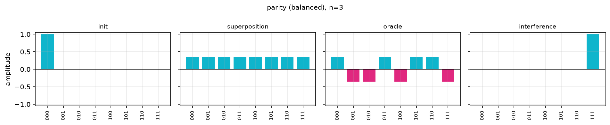

**Query complexity.** Quantum 1 versus classical deterministic $2^{n-1}+1$. An **adversary simulation** (answer 0 for as long as possible) measures exactly $2^{n-1}+1$ for $n=1..14$.

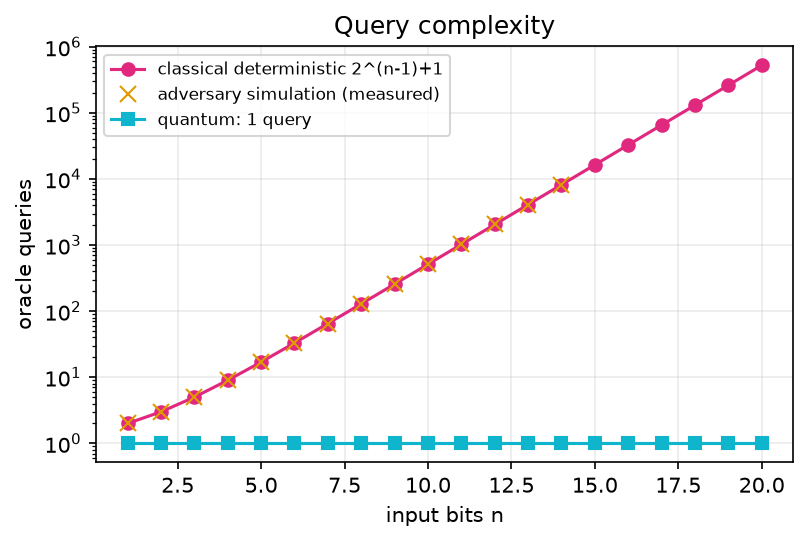

**Noise.** Success degrades with the oracle's entangling-gate count. At $p_2=0.15$, $n=2$: parity (2 CX) scores 0.962 and random balanced (12 CX) scores 0.794. **Pitfall we flag:** at large $n$ the random-balanced oracles (288–3904 CX) *appear* to succeed 94–98% under noise, but only because the output is nearly uniform and $P(\text{non-zero})\to1-2^{-n}$ by chance. The discrimination $P_0(\text{const})-P_0(\text{bal})$ removes this artefact and decays monotonically.

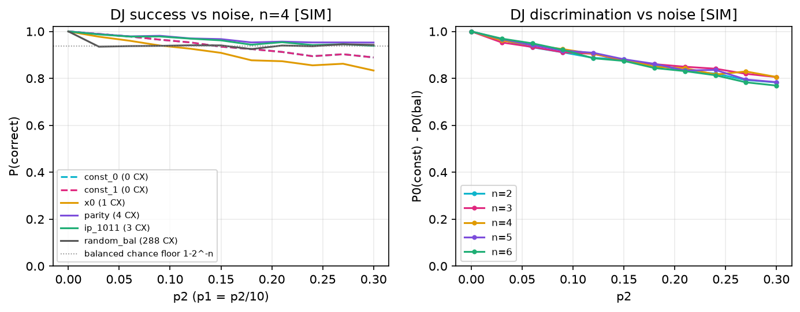

**Real hardware [HW, ibm_marrakesh].** All 10 circuits are classified correctly. Success is 0.98–0.998 for constant and parity oracles, and 0.888 (n=2, 19 two-qubit gates) and 0.855 (n=3, 75 two-qubit gates) for random balanced oracles. The **teleported-ancilla distributed DJ** ran as one dynamic circuit on hardware: 0.996 (constant) and 0.861 (parity). EMU predicted the same ordering (0.95 and 0.89 for random balanced).

## 4. The integrated mission: teleported-ancilla Deutsch–Jozsa

The QRNG pool seeds a Haar-random state, the DJ size $n$ and a hidden oracle. Alice teleports the state (Stage 2). Then she teleports $|-\rangle$, which **Bob uses as the DJ ancilla** (Stage 3, one dynamic circuit). One noise knob drives all stages.

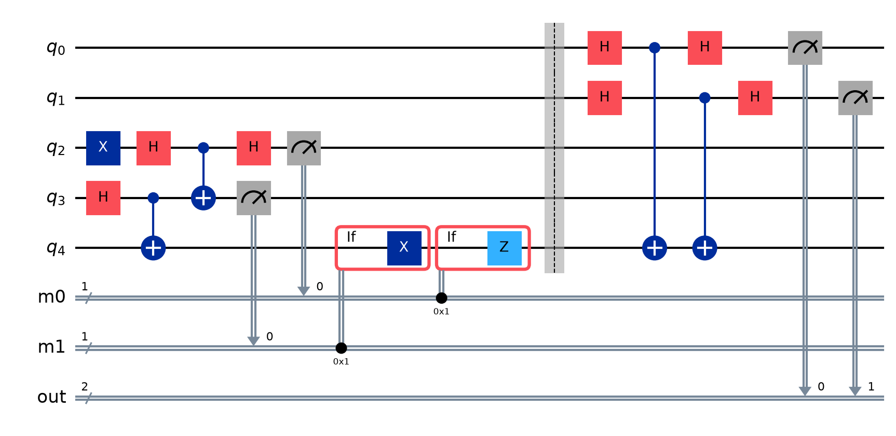

**Result (proved in THEORY §4, verified numerically).** With a noiseless oracle, constant oracles are always correct, and $P(\text{correct}\mid\text{balanced})=\langle-|\rho_{anc}|-\rangle$, **the teleportation fidelity of the ancilla**. A $|+\rangle$ admixture gives no kickback, so teleportation noise makes Bob over-report "constant". Across $p_2\in[0,0.6]$ the agreement is within 0.009 (shot noise).

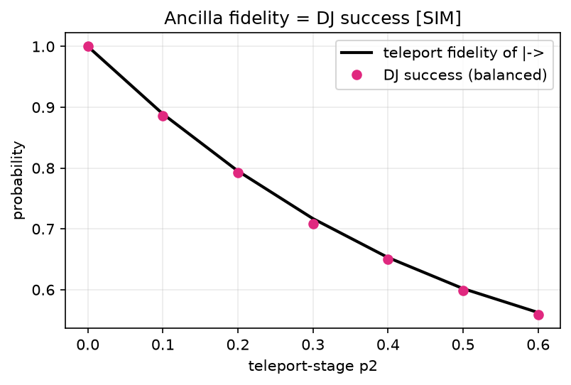

**Which stage hurts more?** For a shallow oracle (parity, n=3) teleport-stage noise dominates: $p_2=0.4$ gives 0.636 when confined to teleportation versus 0.933 when confined to the oracle. In the ideal case, the teleported ancilla is identical to a local one for every library oracle ($n\le4$, both variants).

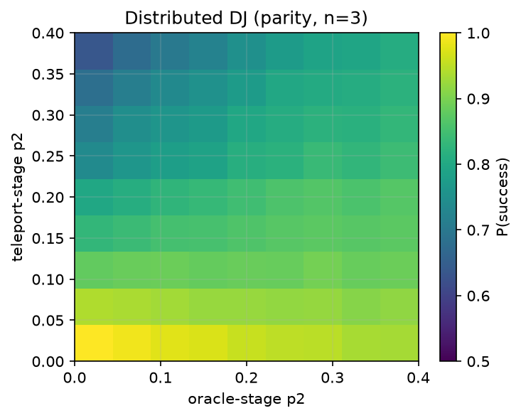

## 5. Testing, limitations, future work

**Tests (53, all passing).** Exact teleport fidelity (all branches, 50 random states, both variants), PTM = I, analytic noise formula, exhaustive DJ $n\le3$, bit/phase oracle equivalence, the adversary count, extractor improvement, monotone fidelity and the 2/3 crossing, the mitigation ceiling, the ancilla-fidelity theorem, mission event order, and every API endpoint plus the WebSocket. The UI is smoke-tested headlessly with zero console errors.

**Limitations.** SIM randomness is pseudo-random. EMU uses a calibration snapshot, not today's device. The Toeplitz extractor's guarantee assumes the per-bit min-entropy estimate holds, which is plug-in and i.i.d. assumed. The tomography projection onto the Bloch ball is a simple constrained estimate, not full maximum likelihood.

**Future work.** Mitigate the feed-forward dephasing (dynamical decoupling during the classical wait). Add Pauli twirling and dynamical decoupling to the teleportation circuit. Use entanglement-swapping relays (multi-hop Q-Relay). Add device-independent randomness certification via a CHSH test.

*References: see `docs/REFERENCES.md`.*
